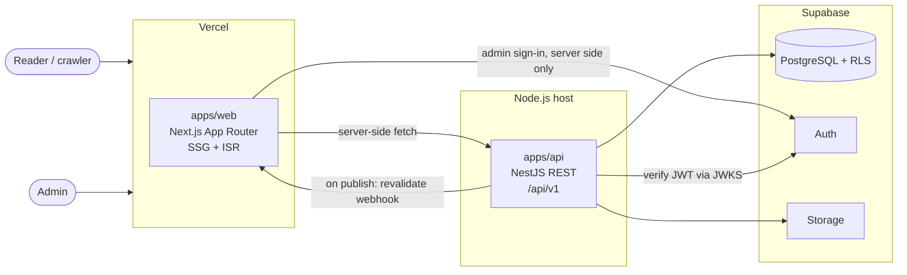
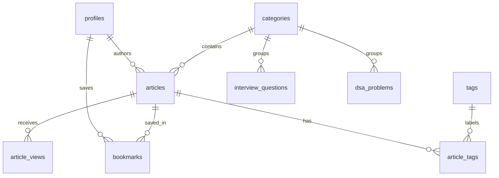

# BackendMasters — Architecture

**Domain:** backendmasters.in · **Tagline:** Learn. Build. Design. Scale.

## 1. System overview



**The rule that shapes everything:** the web app talks to one backend, the NestJS API. The only Supabase call the web app makes is admin sign-in through Supabase Auth, on the server, in `lib/supabase/server.ts` (the proxy also refreshes the session).

## 2. Repository layout

```
backendmasters/
├── apps/
│   ├── web/                  Next.js (Vercel)
│   │   └── src/
│   │       ├── app/          Routes only: thin, compose features
│   │       ├── components/   ui/ (shadcn), illustrations/, layout/, motion/
│   │       ├── features/     articles/, dsa/, interview/, search/, admin/
│   │       └── lib/          api/ (the only HTTP client), supabase/ (auth only), env.ts
│   └── api/                  NestJS (separate Node host)
│       └── src/
│           ├── config/       Validated environment
│           ├── common/       Filters, interceptors, guards, decorators
│           ├── supabase/     Client factory (public / user-scoped / admin)
│           └── modules/      health/, articles/, categories/, tags/, dsa/, interview/, search/, media/
├── packages/
│   └── shared/               Types and contracts used by both apps
├── supabase/                 config.toml, migrations/, seed.sql
├── docs/                     This document, design system, implementation plan
└── TASKS.md                  Phase checklist
```

Each NestJS module follows `controller → service → repository`. Only repositories touch Supabase, so business logic stays testable without a database.

## 3. Key decisions

| #   | Decision                                                                                      | Why                                                                                                                                                                                   |
| --- | --------------------------------------------------------------------------------------------- | ------------------------------------------------------------------------------------------------------------------------------------------------------------------------------------- |
| D1  | **npm workspaces + Turborepo**                                                                | No global tool to install, matches your other projects, and Vercel supports it natively.                                                                                              |
| D2  | **TypeScript 6.0, not 7**                                                                     | `@nestjs/swagger` (`^5.5 \|\| ^6`), `typescript-eslint` (`<6.1`) and `@nestjs/cli` (`~6.0`) don't accept 7 yet. Revisit when they do.                                                 |
| D3  | **Public pages use Next.js Cache Components** (`use cache`, `cacheTag`, Partial Prerendering) | Next 16's form of SSG + ISR. Articles are prerendered and fast to index; unlisted slugs get rendered once, then cached.                                                               |
| D4  | **Publishing triggers on-demand revalidation**                                                | When visible content changes, the API calls a secret-protected `/api/revalidate` route that revalidates the cache tag, so changes appear in seconds without short cache lifetimes.    |
| D5  | **Supabase keys are scoped by purpose**                                                       | Public reads use the publishable key, so RLS applies. Admin writes forward the admin's JWT, so RLS applies again. The secret key is reserved for narrow server jobs (view counting).  |
| D6  | **The API verifies JWTs locally through JWKS**                                                | No network round trip to verify a token. `AdminGuard` then checks `is_admin()`.                                                                                                       |
| D7  | **Markdown renders on the server**                                                            | `react-markdown` runs in Server Components with Shiki, so no grammar or theme reaches the browser. Only the copy button, table of contents, progress bar and Mermaid are client code. |
| D8  | **Markdown is always sanitized**                                                              | `rehype-sanitize` runs even though only admins author content, because a compromised admin account shouldn't become stored XSS for every reader.                                      |
| D9  | **Search uses Postgres full-text**                                                            | A generated `tsvector` column with a GIN index, `websearch_to_tsquery` for queries, `pg_trgm` for suggestions. No extra search service to pay for or sync.                            |
| D10 | **Animation libraries load on demand**                                                        | CSS and SVG by default. See `DESIGN_SYSTEM.md` for the budget per library.                                                                                                            |
| D11 | **Validation by layer**                                                                       | `class-validator` DTOs at the API boundary (needed for Swagger), Zod for frontend forms and environment parsing.                                                                      |

## 4. Data access and security

| Caller            | Credential            | RLS applies?  | Used for                          |
| ----------------- | --------------------- | ------------- | --------------------------------- |
| Public API routes | Publishable key       | Yes           | Reading published content         |
| Admin API routes  | Admin's forwarded JWT | Yes           | Content management, image uploads |
| Server jobs       | Secret key            | No (bypasses) | View counts                       |
| Web server        | Publishable key       | Yes           | Admin sign-in only                |

Defence in depth for admin writes: `AdminGuard` rejects non-admins in the API, and RLS policies check `is_admin()` in the database. A bug in either one alone doesn't expose a write.

### Admin sessions

The browser never holds a usable token in script. Sign-in runs in a Server Action, and the session lives in an `httpOnly` cookie limited to `/admin`, so public pages never receive it. Server Actions and admin pages read the cookie on the server and forward the access token to the API.

- **`proxy.ts` only refreshes the session.** It makes no access decisions. Redirecting there would turn a session that expired during a save into a lost edit.
- **Server Actions are public endpoints,** so each validates its input and relies on the API's check rather than on the page having loaded.
- **Article saves are one transaction.** The `save_article` function writes the article and its tags together, runs as the caller so RLS applies, and refuses a save based on an out-of-date version.
- **Uploads are identified by their first bytes,** not by the name or type a client sends. SVG is refused because it can carry scripts. Files get random names.

Setup and day-to-day use are in `ADMIN.md`.

The secret key is never given a `NEXT_PUBLIC_` name and is never set on the Vercel project at all.

### Schema



Defined in `supabase/migrations`. Three rules are worth knowing before changing it:

- **Default privileges are revoked.** Supabase's blanket table grants are removed and each privilege is granted explicitly, so a new table needs its own grants and policies.
- **Roles can't be self-assigned.** `profiles.role` has no read or write grant for ordinary users, and is ignored in sign-up metadata. Only SQL with elevated rights can make someone an admin. `is_admin()` is the only way policies check it.
- **Scheduled content stays hidden.** Public reads need `status = 'published' and published_at <= now()`, so a future date works as scheduling.

`category_summaries` is a `security_invoker` view, so RLS still applies to whoever queries it.

All tables use UUID primary keys (`article_tags` uses its two foreign keys), `created_at` / `updated_at` with a shared trigger, and unique slugs. `dsa_problems` holds per-language solutions (JavaScript, TypeScript, Java, Go) as validated JSONB, since they're always read together with the problem.

## 5. API conventions

- Testing: Vitest (unit) and Vitest + Supertest (integration). Linting: oxlint in the API, ESLint in the web app, both as scaffolded.
- Base path `/api/v1`, Swagger UI at `/api/docs` (disabled in production unless `SWAGGER_ENABLED=true`).
- Success: `{ "data": ..., "meta": { "requestId": "...", "timestamp": "..." } }`, with pagination fields added to `meta`.
- Error: `{ "error": { "code": "...", "message": "...", "details": ... }, "meta": { ... } }`.
- Envelope types live in `packages/shared`, so the web client and the API can't drift apart.

## 6. How article pages behave

`/articles/[slug]` is a blocking route (`instant = false`), so a page published after the build still arrives as complete HTML on the first visit.

| Situation                    | Reader                                          | Googlebot                          |
| ---------------------------- | ----------------------------------------------- | ---------------------------------- |
| Article known at build       | Instant, full HTML                              | Same                               |
| Published after the build    | First request waits for the render, then cached | Same, with complete HTML and title |
| Missing or draft, first hit  | Not-found page, status 200, `noindex`           | Same                               |
| Missing or draft, after that | Not-found page, status 404, `noindex`           | Same                               |
| API down, article not cached | "Couldn't be loaded" page with retry            | Status 500, so it retries later    |

Measured on a production build. Status 404 needs the empty result to be in the cache already, and publishing clears that cache, so a crawler can see status 200 on a missing page. `noindex` keeps that page out of search results either way.

Other things to know:

- `generateStaticParams` must return at least one item, so a placeholder slug is used when the API is unreachable or nothing is published. That keeps such builds from failing.
- `use cache` results persist in `.next/cache` across builds. Delete that folder when testing against changed local data without going through the admin area.
- **Content changes appear on the next request.** The API calls `/api/revalidate`, which expires the `content` cache tag with no stale period. Every public query carries that tag. The route's tag is fixed, so its secret can't be used for anything else.

## 7. How the learning modules work

| Track                                                | Content                                                          | Where it lives                                                               |
| ---------------------------------------------------- | ---------------------------------------------------------------- | ---------------------------------------------------------------------------- |
| DSA                                                  | Problems with examples, approaches, a dry run and four languages | `dsa_problems`, `/dsa`, `/dsa/[slug]`                                        |
| Interview                                            | Searchable questions with filters                                | `interview_questions`, `/interview-questions`, `/interview-questions/[slug]` |
| LLD, HLD, system design, AWS, observability, backend | Articles grouped into topics                                     | `articles`, by tag                                                           |

- **Topics are tags.** A topic's tag slug is its name in `features/catalog/categories.ts` run through `topicAnchor`, and a migration creates those tags so they exist in production. A topic links to its articles as soon as one is published with that tag. Tag an article with the matching topic, or it won't appear under that topic.
- **Sections are Markdown.** Problems and questions store Markdown and render through the same sanitized pipeline as articles. Code goes through `codeFence`, so backticks in code can't break out of the block.
- **Publishing is checked.** A DSA problem needs its core sections and all four languages. A question needs a short answer. Changes clear the same `content` cache tag as articles.
- **The system design format is guidance.** The editor shows which of the ten sections have no heading yet for HLD and system design articles, and can insert the outline. It doesn't block publishing, because a short building-block article may not need all ten.
- **Sample content is local only.** `supabase/seed.sql` holds it, and `supabase db push` doesn't run that file.

## 8. Testing the data layer

| Command            | Needs                                 | Proves                                                             |
| ------------------ | ------------------------------------- | ------------------------------------------------------------------ |
| `npm run db:test`  | Local Supabase                        | 50 pgTAP tests of who can read and write what                      |
| `npm run test:db`  | Local Supabase, seed, `apps/api/.env` | The real API against the real database, signed in as real accounts |
| `npm run test:e2e` | Nothing                               | HTTP behaviour with repositories faked                             |

The pgTAP suite was mutation-tested: exposing drafts, granting role updates and disabling RLS on a table each made it fail.

## 9. Architectural risks

| Risk                                                     | Impact                                                                                              | Mitigation                                                                                                                                         |
| -------------------------------------------------------- | --------------------------------------------------------------------------------------------------- | -------------------------------------------------------------------------------------------------------------------------------------------------- |
| **The API is down during a Vercel build**                | Failed deploy if prerendering depends on it                                                         | Tested: the build succeeds, pages say articles can't be loaded, and that result expires in about a minute so the site recovers without a redeploy. |
| **Cold starts on a low-cost API host**                   | Slow first ISR render                                                                               | Choose an always-on host. Vercel's cache means readers rarely hit the API directly.                                                                |
| **Latency between regions**                              | Every API call pays it                                                                              | Put the API and Supabase in the same region (Mumbai, `ap-south-1`, suits a `.in` audience).                                                        |
| **Animation scope vs Core Web Vitals**                   | The brief lists GSAP, Motion, Lottie and React Flow, and loading all of them would hurt LCP and INP | Per-library budget, lazy loading, reduced-motion fallbacks (see `DESIGN_SYSTEM.md`).                                                               |
| **Phase 2 builds pages before Phase 3 creates the data** | Temptation to hardcode mock articles                                                                | Phase 2 uses real category config and honest empty states behind a typed data interface. No fixture articles ship.                                 |
| **`/hld` and `/system-design` overlap**                  | Duplicate content, split SEO                                                                        | `/hld` covers building blocks (caching, sharding). `/system-design` covers end-to-end case studies. Articles link across.                          |
| **Platform launches empty**                              | SEO and design both need real content                                                               | Content is a workstream of its own. See the open questions in `IMPLEMENTATION_PLAN.md`.                                                            |
| **Page transitions in the App Router**                   | `AnimatePresence` exit animations are unreliable across route changes                               | Use the browser View Transitions API with graceful fallback. Test in Phase 2.                                                                      |
| **New major versions** (Nest 12, Next 16, TS 6)          | Examples online may be outdated                                                                     | Generated from the official scaffolds; exact versions committed through the lockfile.                                                              |

## 10. Deployment

- **Web:** Vercel project with root directory `apps/web`.
- **API:** Container on an always-on Node host. Railway, Render, Fly.io and ECS Fargate all fit; to be chosen in Phase 7 (Dockerfile added then).
- **Database:** Supabase. Migrations in `supabase/migrations` are the source of truth, applied with `supabase db push`.
- **Domains:** `backendmasters.in` → web, `api.backendmasters.in` → API.
