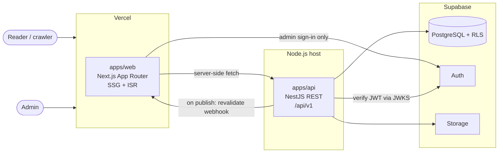
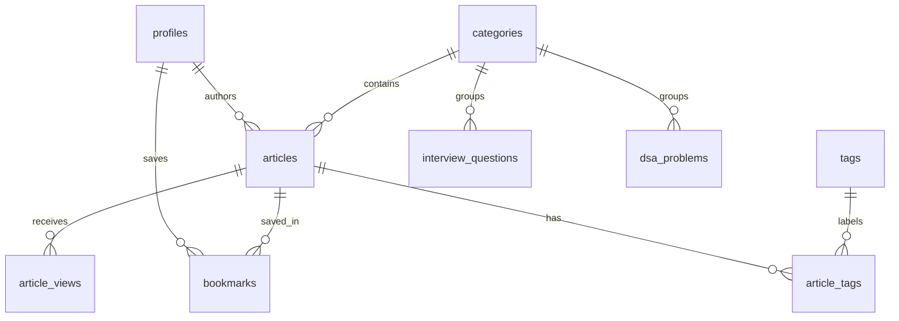

# BackendMasters — Architecture

**Domain:** backendmasters.in · **Tagline:** Learn. Build. Design. Scale.

## 1. System overview



**The rule that shapes everything:** the web app talks to one backend, the NestJS API. The only Supabase call the frontend makes is admin sign-in through Supabase Auth, and that lives in a single module.

## 2. Repository layout

```
backendmasters/
├── apps/
│   ├── web/                  Next.js (Vercel)
│   │   └── src/
│   │       ├── app/          Routes only: thin, compose features
│   │       ├── components/   ui/ (shadcn), illustrations/, layout/, motion/
│   │       ├── features/     articles/, dsa/, interview/, search/, admin/
│   │       └── lib/          api/ (the only HTTP client), supabase/ (auth only), env.ts
│   └── api/                  NestJS (separate Node host)
│       └── src/
│           ├── config/       Validated environment
│           ├── common/       Filters, interceptors, guards, decorators
│           ├── supabase/     Client factory (public / user-scoped / admin)
│           └── modules/      health/, articles/, categories/, tags/, dsa/, interview/, search/, media/
├── packages/
│   └── shared/               Types and contracts used by both apps
├── supabase/                 config.toml, migrations/, seed.sql
├── docs/                     This document, design system, implementation plan
└── TASKS.md                  Phase checklist
```

Each NestJS module follows `controller → service → repository`. Only repositories touch Supabase, so business logic stays testable without a database.

## 3. Key decisions

| #   | Decision                                                                                      | Why                                                                                                                                                                                           |
| --- | --------------------------------------------------------------------------------------------- | --------------------------------------------------------------------------------------------------------------------------------------------------------------------------------------------- |
| D1  | **npm workspaces + Turborepo**                                                                | No global tool to install, matches your other projects, and Vercel supports it natively.                                                                                                      |
| D2  | **TypeScript 6.0, not 7**                                                                     | `@nestjs/swagger` (`^5.5 \|\| ^6`), `typescript-eslint` (`<6.1`) and `@nestjs/cli` (`~6.0`) don't accept 7 yet. Revisit when they do.                                                         |
| D3  | **Public pages use Next.js Cache Components** (`use cache`, `cacheTag`, Partial Prerendering) | Next 16's form of SSG + ISR. Articles are prerendered and fast to index; unlisted slugs get rendered once, then cached.                                                                       |
| D4  | **Publishing triggers on-demand revalidation**                                                | On publish or unpublish, the API calls a secret-protected `/api/revalidate` route that revalidates the cache tag, so changes appear in seconds without short cache lifetimes.                 |
| D5  | **Supabase keys are scoped by purpose**                                                       | Public reads use the publishable key, so RLS applies. Admin writes forward the admin's JWT, so RLS applies again. The secret key is reserved for narrow server jobs (view counting, storage). |
| D6  | **The API verifies JWTs locally through JWKS**                                                | No network round trip to Supabase on each request. `AdminGuard` then checks `profiles.role`.                                                                                                  |
| D7  | **Markdown renders on the server**                                                            | `react-markdown` + `@shikijs/rehype` run in Server Components, so Shiki's grammars never reach the browser. Only the copy button, TOC and Mermaid are client code.                            |
| D8  | **Markdown is always sanitized**                                                              | `rehype-sanitize` runs even though only admins author content, because a compromised admin account shouldn't become stored XSS for every reader.                                              |
| D9  | **Search uses Postgres full-text**                                                            | A generated `tsvector` column with a GIN index, `websearch_to_tsquery` for queries, `pg_trgm` for suggestions. No extra search service to pay for or sync.                                    |
| D10 | **Animation libraries load on demand**                                                        | CSS and SVG by default. See `DESIGN_SYSTEM.md` for the budget per library.                                                                                                                    |
| D11 | **Validation by layer**                                                                       | `class-validator` DTOs at the API boundary (needed for Swagger), Zod for frontend forms and environment parsing.                                                                              |

## 4. Data access and security

| Caller            | Credential            | RLS applies?  | Used for                        |
| ----------------- | --------------------- | ------------- | ------------------------------- |
| Public API routes | Publishable key       | Yes           | Reading published content       |
| Admin API routes  | Admin's forwarded JWT | Yes           | Content management              |
| Server jobs       | Secret key            | No (bypasses) | View counts, storage operations |
| Browser           | Publishable key       | Yes           | Admin sign-in only              |

Defence in depth for admin writes: `AdminGuard` rejects non-admins in the API, and RLS policies check `is_admin()` in the database. A bug in either one alone doesn't expose a write.

The secret key is never given a `NEXT_PUBLIC_` name and is never set on the Vercel project at all.

### Planned schema (Phase 3)



All tables use UUID primary keys, `created_at` / `updated_at` with a shared trigger, and unique slugs. `dsa_problems` holds per-language solutions (JavaScript, TypeScript, Java, Go) as validated JSONB, since they're always read together with the problem.

## 5. API conventions

- Testing: Vitest (unit) and Vitest + Supertest (integration). Linting: oxlint in the API, ESLint in the web app, both as scaffolded.
- Base path `/api/v1`, Swagger UI at `/api/docs` (disabled in production unless `SWAGGER_ENABLED=true`).
- Success: `{ "data": ..., "meta": { "requestId": "...", "timestamp": "..." } }`, with pagination fields added to `meta`.
- Error: `{ "error": { "code": "...", "message": "...", "details": ... }, "meta": { ... } }`.
- Envelope types live in `packages/shared`, so the web client and the API can't drift apart.

## 6. Architectural risks

| Risk                                                     | Impact                                                                                              | Mitigation                                                                                                                                                                   |
| -------------------------------------------------------- | --------------------------------------------------------------------------------------------------- | ---------------------------------------------------------------------------------------------------------------------------------------------------------------------------- |
| **The API is down during a Vercel build**                | Failed deploy if prerendering depends on it                                                         | `generateStaticParams` tolerates failure and pages fall back to on-demand rendering. Verify in Phase 4, along with crawlers receiving full article HTML for streamed routes. |
| **Cold starts on a low-cost API host**                   | Slow first ISR render                                                                               | Choose an always-on host. Vercel's cache means readers rarely hit the API directly.                                                                                          |
| **Latency between regions**                              | Every API call pays it                                                                              | Put the API and Supabase in the same region (Mumbai, `ap-south-1`, suits a `.in` audience).                                                                                  |
| **Animation scope vs Core Web Vitals**                   | The brief lists GSAP, Motion, Lottie and React Flow, and loading all of them would hurt LCP and INP | Per-library budget, lazy loading, reduced-motion fallbacks (see `DESIGN_SYSTEM.md`).                                                                                         |
| **Phase 2 builds pages before Phase 3 creates the data** | Temptation to hardcode mock articles                                                                | Phase 2 uses real category config and honest empty states behind a typed data interface. No fixture articles ship.                                                           |
| **`/hld` and `/system-design` overlap**                  | Duplicate content, split SEO                                                                        | `/hld` covers building blocks (caching, sharding). `/system-design` covers end-to-end case studies. Articles link across.                                                    |
| **Platform launches empty**                              | SEO and design both need real content                                                               | Content is a workstream of its own. See the open questions in `IMPLEMENTATION_PLAN.md`.                                                                                      |
| **Page transitions in the App Router**                   | `AnimatePresence` exit animations are unreliable across route changes                               | Use the browser View Transitions API with graceful fallback. Test in Phase 2.                                                                                                |
| **New major versions** (Nest 12, Next 16, TS 6)          | Examples online may be outdated                                                                     | Generated from the official scaffolds; exact versions committed through the lockfile.                                                                                        |

## 7. Deployment

- **Web:** Vercel project with root directory `apps/web`.
- **API:** Container on an always-on Node host. Railway, Render, Fly.io and ECS Fargate all fit; to be chosen in Phase 7 (Dockerfile added then).
- **Database:** Supabase. Migrations in `supabase/migrations` are the source of truth, applied with `supabase db push`.
- **Domains:** `backendmasters.in` → web, `api.backendmasters.in` → API.
